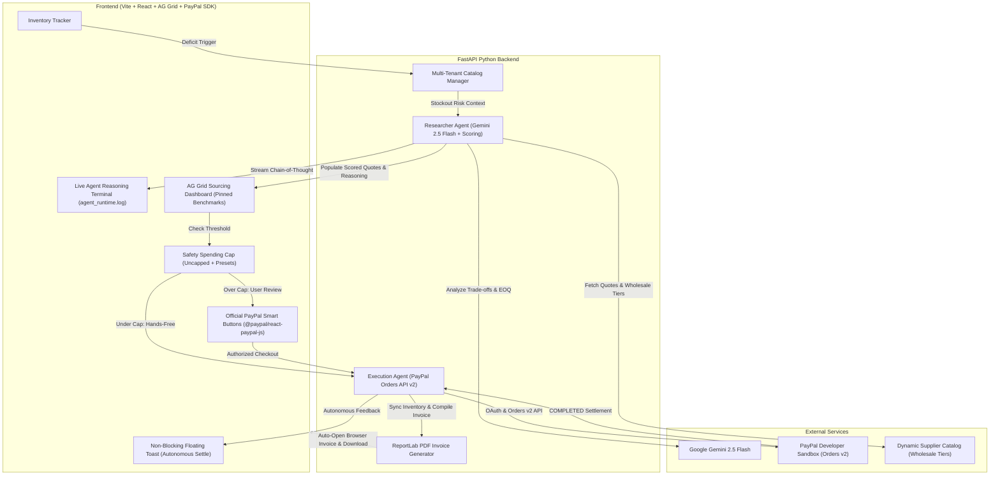

# Restock.ai

> **"Autonomous, budget-capped inventory procurement with human-in-the-loop PayPal execution."**

Built for the **PayPal AI Hackathon 2026** on Devpost.


---

## Overview

Small business owners spend up to **15 hours every week** manually monitoring inventory, calling suppliers, comparing delivery lead-times, and calculating reorder quantities. A single stockout can cost thousands in lost revenue, while over-ordering locks up precious working capital.

**Restock.ai** is an autonomous procurement platform that puts an AI agent behind the wheel of small business inventory. When stock levels dip below safe thresholds, our autonomous **Researcher Agent** scans supplier networks, evaluates trade-offs between price and delivery speed, and populates an enterprise-grade **AG Grid** financial dashboard. 

Crucially, the agent operates under strict **Smart Budget Caps**:
* **Under Cap (Autonomous Mode)**: Pre-authorized purchases are automatically executed and captured via the **PayPal Orders API v2** with zero manual friction, verified by an instant non-blocking floating Toast notification.
* **Over Cap / Zero-Trust Mode**: The agent halts spending and prompts the business owner for **human-in-the-loop sign-off** using the official **PayPal Smart Payment Buttons** (`@paypal/react-paypal-js`).
* **Post-Payment Reconciliation**: Upon PayPal settlement confirmation, inventory auto-replenishes and an official audit-ready PDF tax invoice is compiled via **ReportLab** and popped open on screen with authentic capture IDs.

---

## System Architecture



---

## Target Prizes and Key Features

### 1. Best Use of PayPal + AI & Agentic Commerce ($5,000 Each)
* **Official PayPal React SDK (`@paypal/react-paypal-js`)**: Integrates official PayPal Smart Payment Buttons inside the checkout review modal, triggering authentic PayPal popup checkout flows for verified transactions.
* **Real PayPal Orders API v2 Integration**: Direct backend integration with `/v1/oauth2/token`, `/v2/checkout/orders` (`intent: "CAPTURE"`), and `/v2/checkout/orders/{id}/capture` within the PayPal Sandbox environment.
* **Dual Execution Modes**:
  * **Autonomous Pre-Authorized**: When total cost falls within the merchant's configured budget cap, the agent executes and captures payment hands-free. A non-blocking, dark-emerald floating Toast notification confirms settlement without interrupting browser workflow.
  * **Human-in-the-Loop Safeguard**: When total cost exceeds the budget cap (or in `$0` Zero-Trust mode), spending automatically halts, opening the human review dialog with official PayPal payment execution.
* **Dynamic Wholesale Discounting & EOQ Analysis**: The agent analyzes supplier-specific volume pricing curves to identify optimal Economic Order Quantity (EOQ) bulk tiers (e.g., unlocking $148+ in volume savings on bulk orders).

### 2. Best Use of AG Grid ($5,000 1st Place Prize)
* **High-Performance Procurement Dashboard**: Displays supplier comparison rows with instant client-side quick filtering and multi-column sorting.
* **Custom Cell Renderers**:
  * Glowing **"AI Top Pick"** sparkle badge on the winning supplier.
  * Color-coded **Delivery Speed Pills** (Purple: Next Day, Green: 2-3 Days).
  * Visual **Star Rating meters**.
  * **Savings vs. Average** badges (`-$34.50`).
* **Pinned Bottom Benchmark Row**: Permanently anchors the **"Market Benchmark Average"** row aggregating market price, freight, lead time, and reliability across suppliers.

### 3. Production Enterprise Architecture & Audit Reconciliation
* **Multi-Tenant Business Switcher**: Instantly toggles between 3 realistic commercial environments:
  * **Bean & Brew Roastery** (*Specialty Coffee Shop* -> Colombian Beans)
  * **Apex Drone & Tech Labs** (*Electronics Repair* -> LiPo Battery Packs)
  * **EcoBox Packaging Co** (*E-Commerce Logistics* -> Shipping Boxes)
* **Automated On-Screen PDF Invoicing (ReportLab)**: Dynamically generates audit-ready PDF invoices stamped with official PayPal Sandbox Capture IDs, itemized line items, and financial reconciliation summaries that automatically download and open on screen in a new browser tab.
* **Live Streaming Agent Logs**: Transparent agentic decision-making rendered via simulated streaming `agent_runtime.log` terminal output.

---

## Tech Stack

* **Frontend**: React 19, Vite, TypeScript, Tailwind CSS v4, **AG Grid Community v36**, **@paypal/react-paypal-js**, Lucide Icons, Axios.
* **Backend**: Python 3.10+, **FastAPI**, Uvicorn, Pydantic v2, HTTPX (async REST client), **ReportLab** (PDF invoice generation), python-dotenv.
* **AI Engine**: **Google Gemini 2.5 Flash** (via REST API) + Multi-Criteria Decision Analysis (MCDA) fallback.
* **Payment Engine**: **PayPal Developer Platform** (PayPal Orders API v2 Sandbox).

---

## Quickstart and Local Setup

### Prerequisites
* Node.js v18+ and npm
* Python 3.10+
* Git

### 1. Clone Repository & Setup Backend
```bash
git clone https://github.com/Anvi-g/restock.ai.git
cd restock.ai/backend

# Create and activate virtual environment
python3 -m venv venv
source venv/bin/activate

# Install dependencies
pip install -r requirements.txt

# Configure environment variables
cp .env.example .env
# Edit .env and supply your GEMINI_API_KEY, PAYPAL_CLIENT_ID, and PAYPAL_CLIENT_SECRET

# Start FastAPI backend
uvicorn main:app --reload --port 8000
```
Backend Swagger docs will be live at `http://localhost:8000/docs`.

### 2. Setup Frontend
In a separate terminal:
```bash
cd restock.ai/frontend

# Install dependencies
npm install

# Start Vite development server
npm run dev
```
Frontend will be live at `http://localhost:5173`.

---

## 30-Second Demo Walkthrough (For Judges)

1. **Trigger Stockout Alert**: Click **"Simulate Low Stock"** in the top navbar (Stock drops to 4 units).
2. **Wake the Agent**: Click **"Trigger Agent"** -- watch the Gemini agent scan suppliers, select the top deal, detect wholesale bulk discount opportunities, and stream its thoughts to the `agent_runtime.log` terminal.
3. **Inspect the Market**: Explore the **AG Grid** dashboard -- sort by price, filter suppliers, and observe the pinned **Market Benchmark Average** row.
4. **Test the Guardrail**:
   * Set the Spending Cap to **`$500`** -> Notice status turns to **"Autonomous Pre-Authorized"**. Click **"Auto-Execute via PayPal"** for instant hands-free settlement confirmed by a sleek floating Toast notification.
   * Set the Spending Cap to **`$75`** -> Notice status turns to **"Human-in-the-Loop Required"**. Click **"Approve & Pay"** to open the human review modal powered by official PayPal Smart Buttons.
5. **Reconciliation**: Once captured, inventory auto-replenishes. The system immediately compiles and opens an audit-ready **ReportLab PDF Receipt** in a new browser tab, stamped with the authentic PayPal Capture ID!

---

## License

This project is licensed under the **MIT License** -- see the [LICENSE](LICENSE) file for details.
