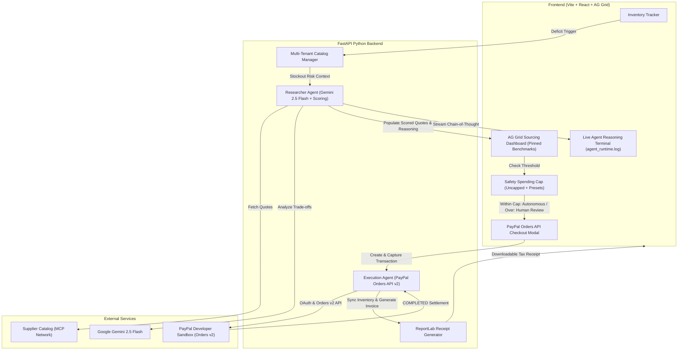

# Restock.ai 🛒🤖

> **"Autonomous, budget-capped inventory procurement with human-in-the-loop PayPal execution."**

Built for the **PayPal AI Hackathon 2026** on Devpost.

---

## 🌟 Overview

Small business owners spend up to **15 hours every week** manually monitoring inventory, calling suppliers, comparing delivery lead-times, and calculating reorder quantities. A single stockout can cost thousands in lost revenue, while over-ordering locks up precious working capital.

**Restock.ai** is an autonomous procurement platform that puts an AI agent behind the wheel of small business inventory. When stock levels dip below safe thresholds, our autonomous **Researcher Agent** scans supplier networks, evaluates trade-offs between price and delivery speed, and populates an enterprise-grade **AG Grid** financial dashboard. 

Crucially, the agent operates under strict **Smart Budget Caps**:
* **Under Cap (Autonomous Mode)**: Pre-authorized purchases are automatically executed and captured via the **PayPal Orders API v2** with zero manual friction.
* **Over Cap / Zero-Trust Mode**: The agent halts spending and prompts the business owner for **human-in-the-loop sign-off**.
* **Post-Payment Reconciliation**: Upon PayPal settlement confirmation, inventory auto-replenishes and an official audit-ready PDF tax invoice is compiled via **ReportLab**.

---

## 🏛️ System Architecture



---

## 🎯 Target Prizes & Key Features

### 1. Best Use of PayPal + AI & Agentic Commerce ($5,000 Each)
* **Real PayPal Orders API v2 Integration**: Directly uses `/v1/oauth2/token`, `/v2/checkout/orders` with `intent: "CAPTURE"`, and `/v2/checkout/orders/{id}/capture` in the PayPal Sandbox environment.
* **Dual Execution Modes**:
  * **⚡ Autonomous Pre-Authorized**: When total cost is within the user's budget cap, the agent executes and captures payment via PayPal in a single, hands-free transaction.
  * **🛡️ Human-in-the-Loop Safety**: When total cost exceeds the budget cap (or in `$0` Zero-Trust mode), the agent halts and prompts the owner for explicit verification.
* **Economic Order Quantity (EOQ) Discovery**: The agent identifies wholesale volume tiers (e.g., upgrading from 26 to 40 units for 25% off, unlocking $148+ in savings).

### 2. Best Use of AG Grid ($5,000 1st Place Prize)
* **High-Performance Procurement Dashboard**: Displays supplier comparison rows with instant sorting and client-side quick filtering.
* **Custom Cell Renderers**:
  * Glowing **"AI Top Pick"** sparkle badge on the winning supplier.
  * Color-coded **Delivery Speed Pills** (Purple: Next Day, Green: 2–3 Days).
  * Visual **Star Rating meters**.
  * **Savings vs. Average** badges (`-$34.50`).
* **Pinned Bottom Summary Row**: Permanently anchors the **"📊 Market Benchmark Average"** row aggregating market price, freight, lead time, and reliability across suppliers.

### 3. Multi-Tenant Enterprise Architecture
* **One-Click Business Switcher**: Instantly toggles between 3 realistic commercial environments:
  * ☕ **Bean & Brew Roastery** (*Specialty Coffee Shop* → Colombian Beans)
  * 🚁 **Apex Drone & Tech Labs** (*Electronics Repair* → LiPo Battery Packs)
  * 📦 **EcoBox Packaging Co** (*E-Commerce Logistics* → Shipping Boxes)
* **Dynamic Inventory Customization**: Shop owners can register custom inventory items, define their own safety thresholds, and specify custom bulk discount targets.
* **Automated PDF Invoicing (ReportLab)**: Generates downloadable tax receipts bearing official PayPal Sandbox Capture Signatures and itemized accounting breakdowns.

---

## 🛠️ Tech Stack

* **Frontend**: React 19, Vite, TypeScript, Tailwind CSS v4, **AG Grid Community v36**, Lucide Icons, Axios.
* **Backend**: Python 3.10+, **FastAPI**, Uvicorn, Pydantic v2, HTTPX (async REST client), **ReportLab** (PDF generation), python-dotenv.
* **AI Engine**: **Google Gemini 2.5 Flash** (via REST API) + Multi-Criteria Decision Analysis (MCDA) fallback.
* **Payment Engine**: **PayPal Developer Platform** (PayPal Orders API v2 Sandbox).

---

## 🚀 Quickstart & Local Setup

### Prerequisites
* Node.js v18+ and npm
* Python 3.10+
* Git

### 1. Clone Repository & Setup Backend
```bash
git clone https://github.com/YOUR_USERNAME/restock.ai.git
cd restock.ai/backend

# Create and activate virtual environment
python3 -m venv venv
source venv/bin/activate

# Install dependencies
pip install -r requirements.txt

# Configure environment variables
cp .env.example .env
# Edit .env and supply your GEMINI_API_KEY, PAYPAL_CLIENT_ID, and PAYPAL_CLIENT_SECRET

# Start FastAPI backend
uvicorn main:app --reload --port 8000
```
Backend Swagger docs will be live at `http://localhost:8000/docs`.

### 2. Setup Frontend
In a separate terminal:
```bash
cd restock.ai/frontend

# Install dependencies
npm install

# Start Vite development server
npm run dev
```
Frontend will be live at `http://localhost:5173`.

---

## 🧪 30-Second Demo Walkthrough (For Judges)

1. **Trigger Stockout Alert**: Click **"Simulate Low Stock"** in the top navbar (Stock drops to 4 bags).
2. **Wake the Agent**: Click **"Trigger Agent"** — watch the Gemini agent scan suppliers, select the top deal, and stream its thoughts to the `agent_runtime.log` terminal.
3. **Inspect the Market**: Explore the **AG Grid** dashboard — sort by price, filter suppliers, and observe the pinned **Market Benchmark Average** row.
4. **Test the Guardrail**:
   * Set the Spending Cap to **`$500`** → Notice status turns to **"⚡ Autonomous Pre-Authorized"**. Click **"Auto-Execute via PayPal"** for instant hands-free settlement.
   * Set the Spending Cap to **`$75`** → Notice status turns to **"🛡️ Human-in-the-Loop Required"**. Click **"Approve & Pay"** to open the human review modal.
5. **Reconciliation**: Once captured, inventory auto-replenishes to 30 bags. Click **"Download PDF Receipt"** to view the audit-ready invoice stamped with the PayPal Capture ID!

---

## 📄 License

This project is licensed under the **MIT License** — see the [LICENSE](LICENSE) file for details.

